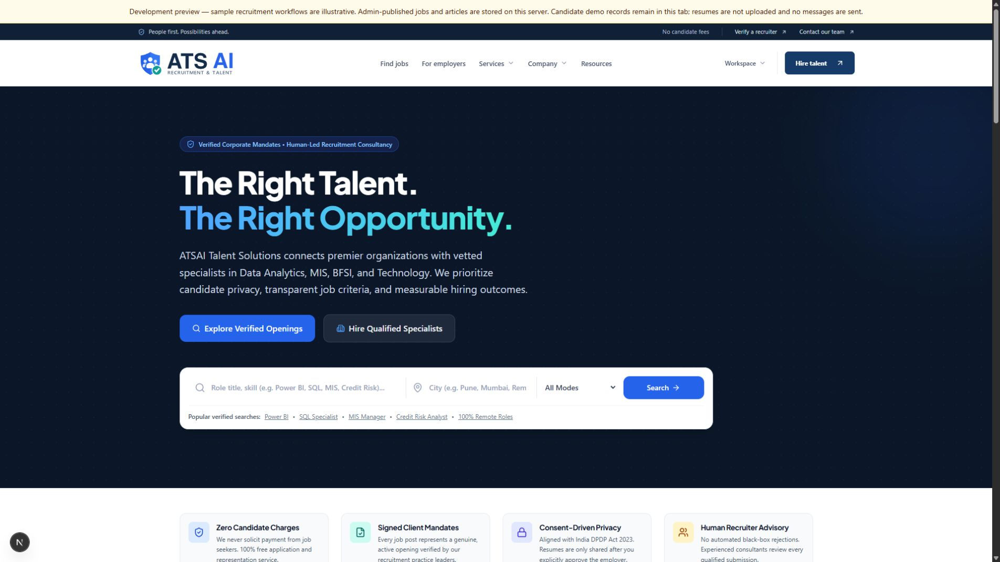
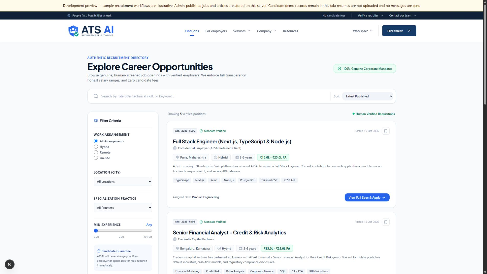
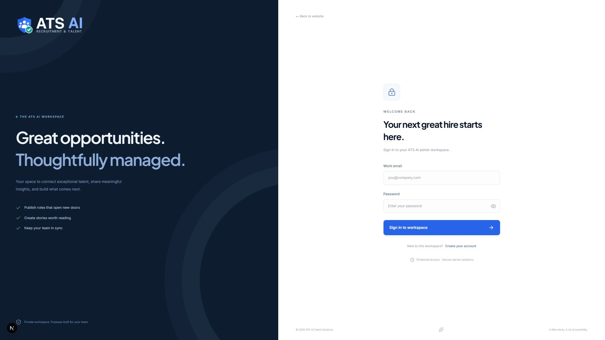
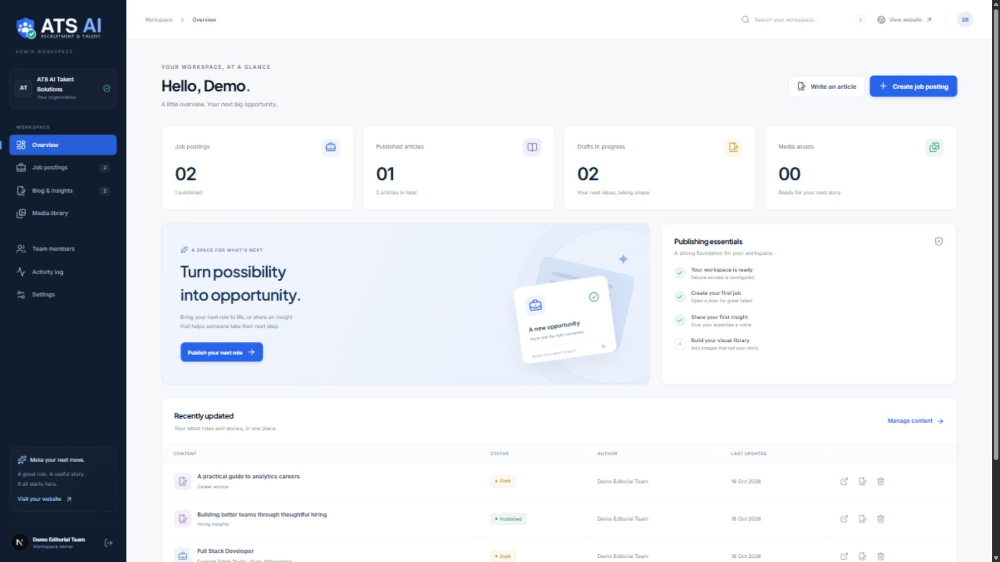
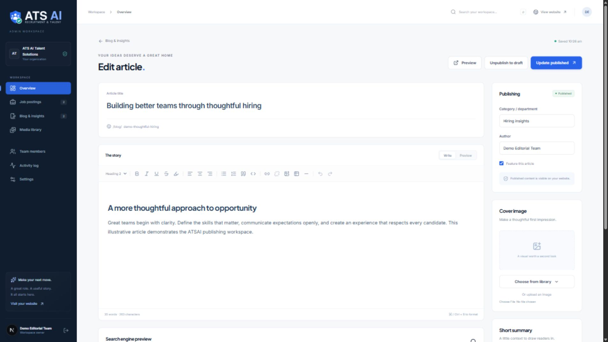

<div align="center">

<a href="https://dattasable.com">
  <picture>
    <source media="(prefers-color-scheme: dark)" srcset="public/brand/atsai-logo-dark.svg" />
    
  </picture>
</a>

# ATSAI Talent Solutions

### Recruitment website. Job publishing. Editorial workspace.

A considered digital experience for connecting talent, sharing expertise, and managing what comes next.

**Created by [Datta Sable](https://dattasable.com)**

[](package.json)
[](tsconfig.json)
[](package.json)
[](https://github.com/sabledattatray/ATSI-Talent/actions/workflows/ci.yml)
[](LICENSE)

[Explore the screenshots](#product-showcase) · [Get started](#quick-start) · [Admin guide](ADMIN.md) · [Datta Sable](https://dattasable.com)

<br />

<a href="docs/screenshots/homepage.png">
  
</a>

<sub>Actual application capture · HD desktop preview</sub>

</div>

---

## A recruitment platform with a publishing core

**ATSAI Talent Solutions** is a Next.js recruitment website and job board with an authenticated admin panel, a rich-text blog CMS, and persistent Turso/SQLite storage. Created by **[Datta Sable](https://dattasable.com)**, the project brings public career discovery and team content publishing into one cohesive experience.

The interface pairs a deep navy foundation with blue and teal accents, clear typography, structured job listings, and a focused editorial workspace. Its recruitment content spans data analytics, business intelligence, MIS, BFSI, and technology careers.

> **Project stage:** Admin authentication, job publishing, and blog publishing are implemented. Candidate, employer, and recruiter workflows are development previews. Real recruitment intake and email services require further integration. See the [release review](RELEASE_AUDIT.md).

## Product showcase

Click any screenshot to view the **HD PNG** (up to 1920 × 1080). All captures come from the running application. Sample openings and editorial records are illustrative; admin captures use a separate preview database.

<table>
  <tr>
    <td width="50%">
      <a href="docs/screenshots/job-search.png"></a>
      <br /><strong>01 / Career discovery</strong><br />Searchable roles, useful filters, and structured job information.
    </td>
    <td width="50%">
      <a href="docs/screenshots/admin-login.png"></a>
      <br /><strong>02 / Workspace access</strong><br />A dedicated sign-in experience for the publishing team.
    </td>
  </tr>
  <tr>
    <td width="50%">
      <a href="docs/screenshots/admin-dashboard.png"></a>
      <br /><strong>03 / Publishing overview</strong><br />Content counts, recent activity, and clear next actions.
    </td>
    <td width="50%">
      <a href="docs/screenshots/blog-editor.png"></a>
      <br /><strong>04 / Editorial workspace</strong><br />Rich content, draft management, previews, and search metadata.
    </td>
  </tr>
</table>

## What you can build and manage

| Experience | Included capabilities |
| :--- | :--- |
| **Recruitment website** | Responsive public pages, service specializations, employer and candidate information, resources, and job discovery. |
| **Job publishing** | Draft, publish, update, and archive roles; manage company, location, work mode, experience, INR compensation, skills, expiry, and external application links. |
| **Blog CMS** | Tiptap editor with headings, lists, links, images, tables, quotes, code blocks, previews, categories, author attribution, and featured posts. |
| **Search metadata** | Editable SEO titles and descriptions, readable slugs, cover images, and public detail pages for published content. |
| **Media library** | PNG, JPEG, and WebP uploads with file-signature validation, reusable image links, and referenced-image deletion protection. |
| **Team workspace** | First-owner setup, invitation-only editor accounts, owner/editor permissions, activity history, and publishing defaults. |
| **Persistent storage** | Turso-backed users, content, sessions, settings, and media on Vercel; local SQLite and backups for local hosting. |

Published jobs appear at `/jobs` and `/jobs/<slug>`. Published articles appear at `/blog`, `/blog/<slug>`, and `/resources`. Drafts remain private; archiving removes public visibility while keeping the record.

## Technology stack

| Layer | Technology |
| :--- | :--- |
| Application | Next.js 16 App Router, React 19, TypeScript 5 |
| Interface | Tailwind CSS 4, custom CSS, Lucide icons |
| Rich-text editing | Tiptap 3 |
| Forms and validation | React Hook Form, Zod |
| Server and persistence | Node.js 24+, Turso via libSQL, local SQLite fallback |
| Authentication | Scrypt password hashing, hashed server-session tokens, HttpOnly cookies |
| Verification | ESLint, TypeScript, Node.js test runner, GitHub Actions |

## Quick start

Install **Node.js 24 or newer** and npm, then run:

```bash
git clone https://github.com/sabledattatray/ATSI-Talent.git
cd ATSI-Talent
npm ci
npm run dev
```

Open **[http://127.0.0.1:3001](http://127.0.0.1:3001)**. The development server binds to loopback on port 3001.

### Set up the admin workspace

1. Open **[http://127.0.0.1:3001/admin](http://127.0.0.1:3001/admin)**.
2. Create the first account to become the workspace owner.
3. Add a job or article, save a draft, and publish when ready.
4. Invite editors from **Team members** to collaborate.

There are no default admin credentials. Subsequent signups require an invitation. The editor saves when you choose **Save draft**, **Publish**, or **Update published**.

### Environment configuration

Copy `.env.example` to `.env.local` if you need custom settings:

| Variable | Purpose |
| :--- | :--- |
| `TURSO_DATABASE_URL` | Hosted database URL supplied by the Vercel Turso integration. |
| `TURSO_AUTH_TOKEN` | Server-only database token supplied by the integration. |
| `ATSAI_DATABASE_PATH` | Local-only SQLite location; defaults to `data/atsai.sqlite`. |
| `ATSAI_ADMIN_ORIGIN` | Exact HTTPS origin for production admin requests. |
| `ATSAI_ADMIN_SETUP_TOKEN` | Random secret of at least 32 characters for the first production owner signup. |

Keep deployment secrets outside Git. Detailed setup, session behavior, invitation rules, and recovery considerations are documented in [ADMIN.md](ADMIN.md).

## Project structure

```text
src/
├── app/                  Public pages, admin routes, and API handlers
├── components/
│   ├── admin/            Dashboard, authentication, editor, and public content views
│   ├── common/           Shared interface and brand components
│   └── layout/           Header, footer, and site chrome
└── lib/
    └── admin/            Authentication, SQLite, validation, and publishing logic
public/brand/             Logo artwork and brand assets
docs/screenshots/         HD product screenshots
scripts/                  Repository checks, brand export, and database backup
tests/                    Admin and recruitment-boundary regression tests
.github/workflows/        Automated project checks
```

## Quality checks

```bash
npm run check:repository
npm run lint
npm run typecheck
npm test
npm run build
```

The test suite covers authentication, permissions, publishing visibility, malformed editor content, media handling, session lifecycle, and recruitment preview boundaries. GitHub Actions runs repository checks, lint, tests, type checking, a production build, and a production dependency audit.

The [release review](RELEASE_AUDIT.md) records the verification baseline and the known development dependency audit limitation.

## Deployment and current scope

Deploy to **Vercel with the connected Turso integration**. The app uses `TURSO_DATABASE_URL` and `TURSO_AUTH_TOKEN` for durable cloud storage, creates missing tables automatically, and never falls back to local files on Vercel. Configure `ATSAI_ADMIN_ORIGIN=https://www.atsai.pro` and a random `ATSAI_ADMIN_SETUP_TOKEN` of at least 32 characters before first-owner signup. See [Turso deployment](docs/TURSO_DEPLOYMENT.md).

For self-hosting without Turso, use a single Node.js server with private persistent disk. Build and start locally with:

```bash
npm run build
npm start -- --hostname 127.0.0.1 --port 3001
```

For local SQLite only, create an online database backup with:

```bash
node scripts/backup-admin.mjs
```

Development builds include sample recruitment records and tab-local demo workspaces. Production builds exclude those samples and restrict demo recruitment routes. Real candidate submissions, resume uploads, employer intake, recruiter verification, SMTP delivery, email password recovery, MFA, and external identity providers are not configured. Production public pages allow search indexing; admin, API, draft-policy, and preview routes remain excluded. The sitemap at `https://www.atsai.pro/sitemap.xml` lists public pages independently of the publishing database. Individual job and article URLs are not yet added to the sitemap.

Private local databases, account records, backups, environment secrets, dependencies, and build outputs are excluded from Git. Turso stores cloud accounts, content, sessions, and uploaded media outside the deployment filesystem. Existing local records are not automatically copied to Turso; migrate them separately if needed. Use Turso backup/export facilities for cloud data.

## Documentation

| Guide | What it covers |
| :--- | :--- |
| [Turso deployment](docs/TURSO_DEPLOYMENT.md) | Vercel integration, environment variables, schema setup, and first-owner signup. |
| [Admin workspace](ADMIN.md) | Accounts, publishing, media, team access, hosting, and backups. |
| [Release review](RELEASE_AUDIT.md) | GitHub publishing checks, verification, and remaining limitations. |
| [Historical audit](AUDIT.md) | Earlier findings and the development-preview baseline. |
| [Product specification](atsai.md) | Intended product direction; includes services beyond the current implementation. |
| [Brand assets](public/brand/README.md) | Logo artwork and export details. |

## Creator and credits

**Datta Sable** — project creator, design direction, and development.

ATSAI Talent Solutions reflects a focus on clear interfaces, thoughtful recruitment experiences, and practical publishing tools.

**Explore more work: [dattasable.com](https://dattasable.com)**

**GitHub: [@sabledattatray](https://github.com/sabledattatray)**

Built with open-source tools including Next.js, React, TypeScript, Tailwind CSS, Tiptap, Lucide, Zod, and SQLite. Their names and marks belong to their respective owners.

## License

Source code is available under the [MIT License](LICENSE). See the license file for its copyright notice and terms. Creator attribution above documents this project's credits; it does not add restrictions to the MIT License.

---

<div align="center">

**Thoughtfully designed. Built with purpose.**

ATSAI Talent Solutions · Created by **[Datta Sable](https://dattasable.com)**

</div>
